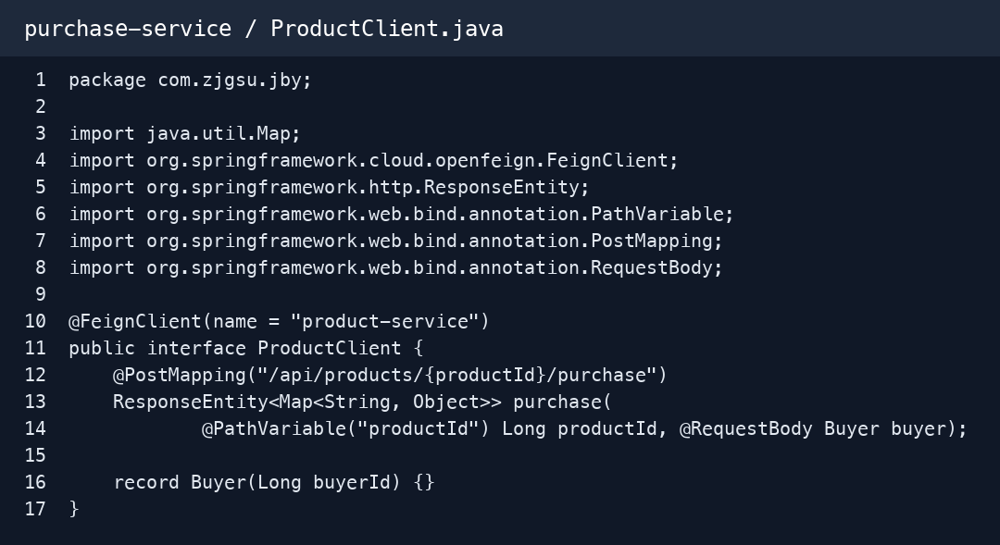
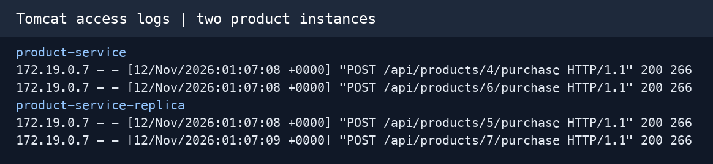
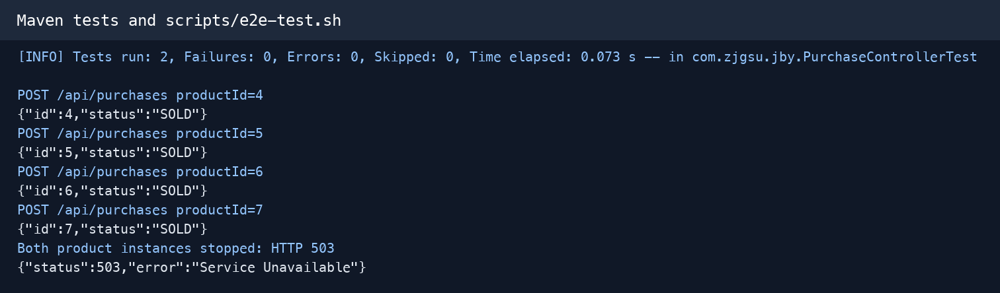

# 第八周 · 服务通信与负载均衡

## 选择一个跨服务业务流程

选用商小淘的购买流程。购买服务接收买家和商品编号，商品服务校验买家及商品状态并更新商品库。接口与时序图见 [服务通信](../../service-communication.md)。

## 使用 OpenFeign

`ProductClient` 以服务名 `product-service` 调用 `POST /api/products/{id}/purchase`。购买服务转发 JSON 响应和状态码，远程故障映射到 HTTP 503。连接超时为 3 秒，读取超时为 5 秒。



## 负载均衡验证

配置好 Nacos 和数据库后，从仓库根目录运行：

```bash
docker compose up -d --build
./scripts/e2e-test.sh
docker compose exec -T product-service sh -c 'cat /tmp/product-tomcat/logs/*'
docker compose exec -T product-service-replica sh -c 'cat /tmp/product-tomcat/logs/*'
```

验证环境使用同一个 Compose 业务拓扑及 Spring Cloud 静态服务发现。商品 4、6 的购买请求到达主实例，商品 5、7 的请求到达副本。默认 Compose 配置使用 Nacos，动态注册尚未单独复测。



## 测试

```bash
mvn -f services/purchase-service/pom.xml test
./scripts/e2e-test.sh
VERIFY_FAILURE=1 ./scripts/e2e-test.sh
```

购买控制器两项测试通过。端到端脚本创建独立测试商品，四笔购买均返回 `SOLD`。故障模式停掉两个商品实例，断言返回 503，并重新启动实例。写请求超时后服务端可能已经提交，重试前应先核对商品状态。


