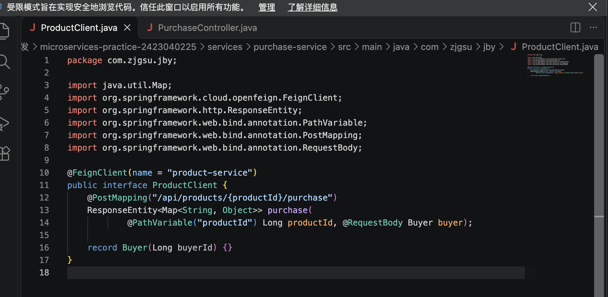
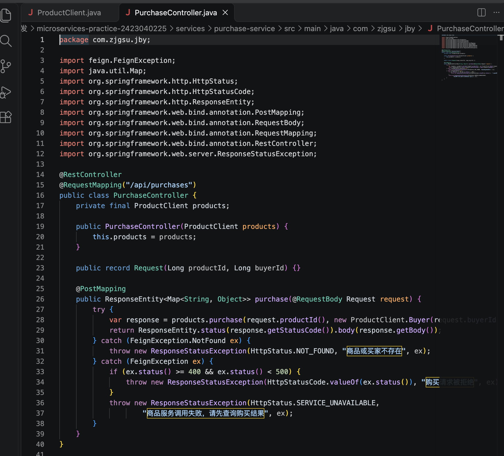
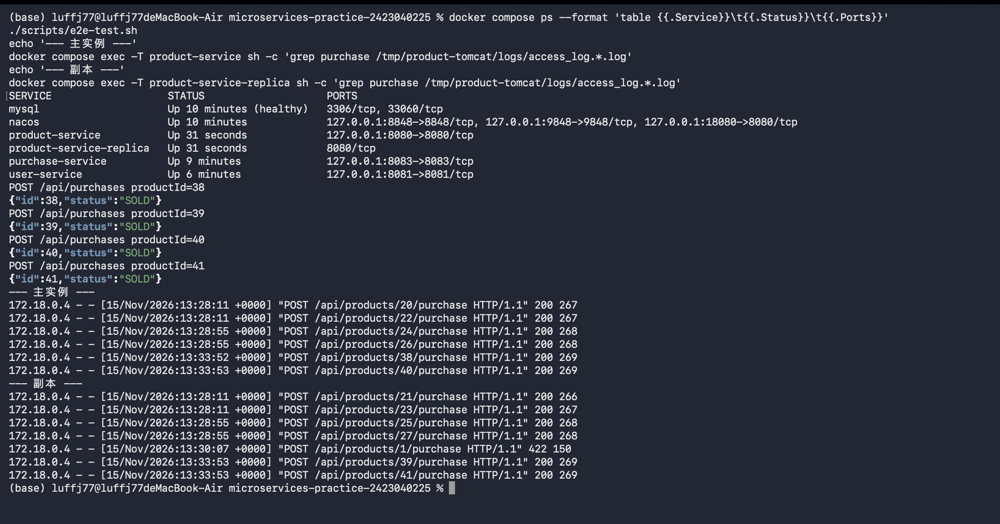
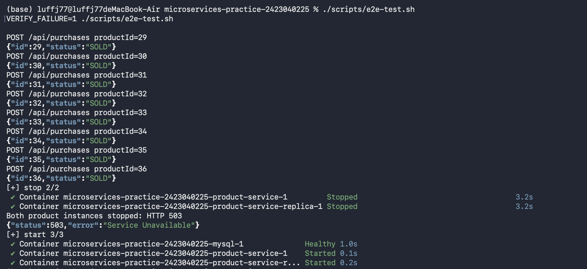

# 第八周 · 服务通信与负载均衡

## 一、跨服务业务流程

选用商小淘的购买流程：

```text
买家 → purchase-service POST /api/purchases
     → OpenFeign POST product-service /api/products/{id}/purchase
     → product-service GET user-service /api/users/{buyerId}
     → product-service 校验并更新商品库
```

`purchase-service` 不直接访问商品库，只通过服务名调用商品服务；商品服务维护商品状态，并在购买前向用户服务确认买家存在。接口、时序图和失败语义见 [服务通信](../../service-communication.md)。

## 二、OpenFeign 实现

`PurchaseApplication` 开启 `@EnableFeignClients`，`ProductClient` 以服务名 `product-service` 声明接口：

```java
@FeignClient(name = "product-service")
public interface ProductClient {
    @PostMapping("/api/products/{productId}/purchase")
    ResponseEntity<Map<String, Object>> purchase(
            @PathVariable("productId") Long productId, @RequestBody Buyer buyer);

    record Buyer(Long buyerId) {}
}
```

`PurchaseService` 调用 Feign 客户端并转发商品服务返回的 JSON 与状态码：

- 远程 404 → 本地 404，提示商品或买家不存在。
- 其他 4xx → 保留原状态码，提示购买请求被拒绝。
- 连接失败、超时或下游 5xx → 503，提示先查询购买结果。

超时由 `application.yml` 配置：连接 3 秒、读取 5 秒。写请求读超时时，商品可能已在服务端提交但响应未送达，因此调用方不能直接重试，应先查询商品状态。

运行与验证：

```bash
cp .env.example .env
docker compose up -d --build
./scripts/e2e-test.sh
```

端到端脚本经 `purchase-service` 发起购买，商品状态变为 `SOLD`，证明请求确实跨服务完成。





## 三、负载均衡验证

三个服务均注册到 Nacos 的 `PERSONAL_GROUP`，`product-service` 启动两个实例：主实例映射宿主机 `127.0.0.1:8080`，副本只加入 Compose 网络，不映射宿主机端口。`purchase-service` 通过 Spring Cloud LoadBalancer 按服务名获取实例列表并轮询。

从仓库根目录执行：

```bash
docker compose ps --format 'table {{.Service}}\t{{.Status}}\t{{.Ports}}'
./scripts/e2e-test.sh
echo '=== 主实例 ==='
docker compose exec -T product-service sh -c 'grep purchase /tmp/product-tomcat/logs/access_log.*.log'
echo '=== 副本 ==='
docker compose exec -T product-service-replica sh -c 'grep purchase /tmp/product-tomcat/logs/access_log.*.log'
```

本次购买请求的商品编号在两个实例间交替：

| 实例 | 收到的商品编号 |
| --- | --- |
| 主实例 | 20、22、24、26 |
| 副本 | 21、23、25、27 |

脚本随后创建的测试商品 38/40 到主实例，39/41 到副本，仍保持交替。两侧日志中的购买请求均返回成功状态，说明调用方不是写死地址，而是由 Nacos 提供实例列表、LoadBalancer 完成客户端轮询。



## 四、测试

```bash
mvn -f services/purchase-service/pom.xml test
./scripts/e2e-test.sh
VERIFY_FAILURE=1 ./scripts/e2e-test.sh
```

- `PurchaseControllerTest` 两项测试通过：正常响应透传，下游 503 映射为本地 503。
- 正常模式：脚本创建卖家、买家和独立测试商品，逐笔购买均返回 `SOLD`。
- 故障模式：停掉 `product-service` 与 `product-service-replica` 后，购买接口返回 `503`，脚本随后自动恢复实例。



写操作超时属于结果未知：服务端可能已提交，重试前应先查询商品状态，避免重复购买。

仓库链接：<https://github.com/jjjiang77/microservices-practice-2423040225>
