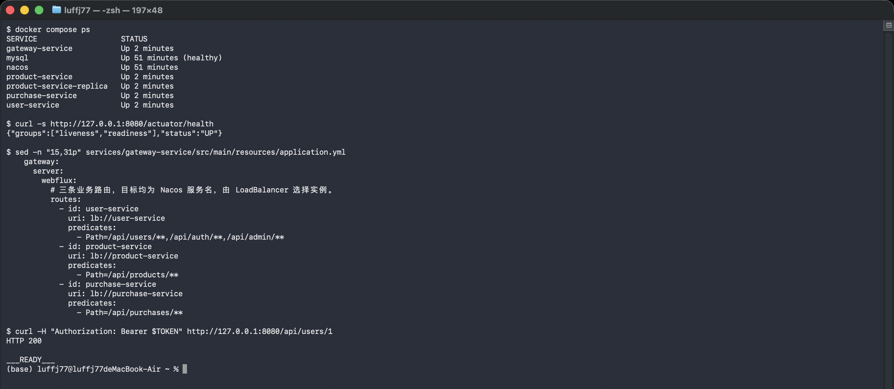
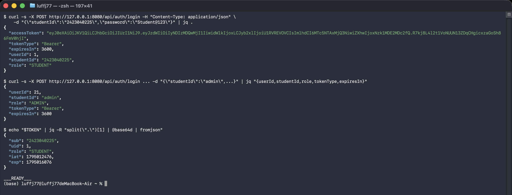
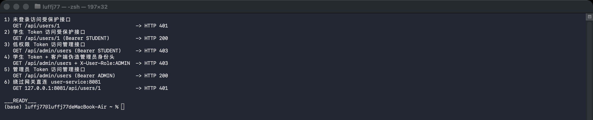
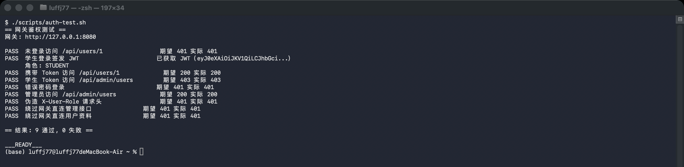

# 第九周 · API 网关与认证授权

本周在商小淘微服务上补齐统一入口与认证授权：

```text
客户端 → gateway-service :8080
          ├── JWT 验签 / 角色校验 / 身份头净化
          ├── lb://user-service      /api/users/**  /api/auth/**  /api/admin/**
          ├── lb://product-service   /api/products/**
          └── lb://purchase-service  /api/purchases/**
```

后三个服务只绑定宿主机回环地址，对外统一从网关进入。

## 一、API Gateway

新增独立工程 `services/gateway-service`，基于 Spring Cloud Gateway（WebFlux）。工程结构：

```text
services/gateway-service/
├── Dockerfile
├── pom.xml
└── src/main/
    ├── java/com/zjgsu/jby/gateway/
    │   ├── GatewayApplication.java
    │   └── security/
    │       ├── AuthGlobalFilter.java     # 全局鉴权过滤器
    │       ├── JwtClaims.java
    │       ├── JwtVerificationException.java
    │       └── JwtVerifier.java          # HS256 验签
    └── resources/application.yml         # 端口 8080、三条路由、健康检查
```

路由表（目标全部使用 Nacos 服务名，由 LoadBalancer 选实例）：

| 路由 id | 断言 | 目标 | 说明 |
| --- | --- | --- | --- |
| user-service | `/api/users/**,/api/auth/**,/api/admin/**` | `lb://user-service` | 用户、登录、管理端 |
| product-service | `/api/products/**` | `lb://product-service` | 商品发布、审核、查询 |
| purchase-service | `/api/purchases/**` | `lb://purchase-service` | 购买流程 |

健康检查入口保留网关自身的 `/actuator/health`，Compose 启动后可直接访问：

```bash
curl -s http://127.0.0.1:8080/actuator/health
# {"status":"UP",...}
```

启动与路由验证：

```bash
cp .env.example .env      # 首次：填入 JWT_SECRET、GATEWAY_INTERNAL_SECRET 与数据库密码
docker compose up -d --build
docker compose ps

# 公开接口：登录（路由到 user-service）
curl -s -X POST http://127.0.0.1:8080/api/auth/login \
  -H 'Content-Type: application/json' \
  -d '{"studentId":"2423040225","password":"Student@123"}'

# 受保护接口：不带 Token 应返回 401
curl -i http://127.0.0.1:8080/api/users/1

# 受保护接口：带 Token 应返回 200
TOKEN=$(curl -s -X POST http://127.0.0.1:8080/api/auth/login \
  -H 'Content-Type: application/json' \
  -d '{"studentId":"2423040225","password":"Student@123"}' | jq -r .accessToken)
curl -s -H "Authorization: Bearer $TOKEN" http://127.0.0.1:8080/api/users/1
```

结果：`/actuator/health` 返回 `UP`；登录请求由网关转发到用户服务；`/api/users/1` 无 Token 为 401，带 Token 为 200。三条路由实测均能转发到下游：`GET /api/users/1` → 200，`GET /api/products/1` → 200，`POST /api/purchases` → 422（由 purchase-service 业务规则返回，说明请求已到达下游而非网关 404）。路由与健康检查截图见 [01-gateway-routes.png](screenshots/01-gateway-routes.png)。



## 二、认证服务

认证代码放在用户服务 `services/user-service`：

| 文件 | 作用 |
| --- | --- |
| `controller/AuthController.java` | `POST /api/auth/login` |
| `service/AuthService.java` | 校验 BCrypt 密码，签发 JWT |
| `security/JwtTokenService.java` | HS256 签发，`sub`=学号、`uid`、`role`、`iat`、`exp` |
| `config/PasswordConfig.java` | `BCryptPasswordEncoder(10)` |
| `dto/LoginRequest.java` / `LoginResponse.java` | 登录入参与响应 |

登录示例：

```bash
curl -s -X POST http://127.0.0.1:8080/api/auth/login \
  -H 'Content-Type: application/json' \
  -d '{"studentId":"admin","password":"Admin@123"}' | jq
```

```json
{
  "accessToken": "eyJ0eXAiOiJKV1QiLCJhbGciOiJIUzI1NiJ9...",
  "tokenType": "Bearer",
  "expiresIn": 3600,
  "userId": 21,
  "studentId": "admin",
  "role": "ADMIN"
}
```

> `userId` 取自主键自增值：本次验证沿用了已有数据卷，管理员为 21；全新数据卷首次初始化时管理员的种子主键为 4。角色与 Token 结构不受影响。

测试账号与角色（密码只写在文档中，数据库与仓库只保存 BCrypt 哈希）：

| 学号 | 密码 | 角色 | 说明 |
| --- | --- | --- | --- |
| 2423040225 | Student@123 | STUDENT | 普通学生 |
| 2423040999 | Student@123 | STUDENT | 普通学生 |
| 2423040001 | Student@123 | STUDENT | 低信用学生 |
| admin | Admin@123 | ADMIN | 管理员 |

密码安全处理：

- 注册 `POST /api/users` 必填 `password`（8-64 位），服务端只写入 BCrypt 哈希。
- `t_user` 新增 `password_hash VARCHAR(100)`，仓库中不存在明文密码。
- 登录失败统一返回 401 `INVALID_CREDENTIALS`，不区分“账号不存在”和“密码错误”。
- `JWT_SECRET`、`GATEWAY_INTERNAL_SECRET` 通过环境变量注入，`.env.example` 只放占位符。

登录响应与 JWT 载荷截图见 [02-login-jwt.png](screenshots/02-login-jwt.png)。



## 三、网关鉴权

`AuthGlobalFilter` 对所有经过网关的请求执行同一套规则：

1. 先删除客户端传入的 `X-User-Id`、`X-User-Role`、`X-Gateway-Secret`，防止伪造；
2. 公开接口放行：`POST /api/auth/login`、`POST /api/users`、`GET /actuator/health`；
3. 其余接口要求 `Authorization: Bearer <JWT>`，缺失或验签失败返回 401；
4. `/api/admin/**` 额外要求 `role=ADMIN`，否则返回 403；
5. 鉴权通过后写入可信身份头与网关内部密钥，再转发给下游。

验证命令：

```bash
# 1. 未登录 → 401
curl -i http://127.0.0.1:8080/api/users/1

# 2. 学生登录后访问 → 200
TOKEN=$(curl -s -X POST http://127.0.0.1:8080/api/auth/login \
  -H 'Content-Type: application/json' \
  -d '{"studentId":"2423040225","password":"Student@123"}' | jq -r .accessToken)
curl -i -H "Authorization: Bearer $TOKEN" http://127.0.0.1:8080/api/users/1

# 3. 学生访问管理员接口 → 403
curl -i -H "Authorization: Bearer $TOKEN" http://127.0.0.1:8080/api/admin/users

# 4. 伪造身份请求头（无 Token）→ 401，且下游收不到伪造头
curl -i http://127.0.0.1:8080/api/admin/users \
  -H 'X-User-Id: 4' -H 'X-User-Role: ADMIN' -H 'X-Gateway-Secret: forged'

# 5. 绕过网关直连用户服务 → 401
curl -i http://127.0.0.1:8081/api/admin/users -H 'X-User-Role: ADMIN'
```

实测结果（本地验证环境）：

```text
GET  /api/users/1                          无 Token          → 401 UNAUTHORIZED
POST /api/auth/login                       学生              → 200 + JWT
GET  /api/users/1                          Bearer 学生 Token → 200
GET  /api/admin/users                      Bearer 学生 Token → 403 ACCESS_DENIED
GET  /api/admin/users                      伪造 X-User-Role  → 401
GET  /api/admin/users                      Bearer 管理员 Token → 200
GET  /api/users/1                          被篡改签名        → 401 INVALID_TOKEN
GET  http://127.0.0.1:8081/api/users/1     绕过网关          → 401 UNTRUSTED_REQUEST
```

下游如何避免绕过网关：

- `GatewayGuardFilter` 位于用户服务，除登录、注册、actuator 外的接口都要求 `X-Gateway-Secret` 与配置值一致，直连 8081 无法读取用户资料或调用管理端。
- 鉴权头由网关验签后重建，客户端自带的同名头在进入路由前已被删除。
- Compose 中业务服务只发布到 `127.0.0.1`，网关是唯一对外入口；生产部署时不映射下游端口。
- 商品服务调用用户服务同样携带该内部密钥（`UserClient`），服务间调用不依赖公网入口。

鉴权结果截图见 [03-gateway-auth.png](screenshots/03-gateway-auth.png)，完整安全说明见 [docs/security.md](../../security.md)。



## 四、测试脚本

新增 [`scripts/auth-test.sh`](../../../scripts/auth-test.sh)，可重复运行，逐条输出 PASS/FAIL 并以退出码反映结果。

```bash
chmod +x scripts/auth-test.sh
./scripts/auth-test.sh
```

覆盖场景：

| 序号 | 场景 | 期望 |
| --- | --- | --- |
| 1 | 未登录访问 `/api/users/1` | 401 |
| 2 | 学生登录签发 JWT | 三段式 Token |
| 3 | 携带 Token 访问 `/api/users/1` | 200 |
| 4 | 学生 Token 访问 `/api/admin/users` | 403 |
| 5 | 错误密码登录 | 401 |
| 6 | 管理员访问 `/api/admin/users` | 200 |
| 7 | 网关伪造 `X-User-Role` | 401 |
| 8 | 绕过网关直连管理接口 | 401 |
| 9 | 绕过网关直连用户资料 | 401 |

典型输出：

```text
== 网关鉴权测试 ==
网关: http://127.0.0.1:8080

PASS  未登录访问 /api/users/1                     期望 401 实际 401
PASS  学生登录签发 JWT                           已获取 JWT（eyJ0eXAiOiJKV1QiLCJh...）
PASS  携带 Token 访问 /api/users/1                期望 200 实际 200
PASS  学生 Token 访问 /api/admin/users            期望 403 实际 403
PASS  错误密码登录                               期望 401 实际 401
PASS  管理员访问 /api/admin/users                 期望 200 实际 200
PASS  伪造 X-User-Role 请求头                     期望 401 实际 401
PASS  绕过网关直连管理接口                        期望 401 实际 401
PASS  绕过网关直连用户资料                        期望 401 实际 401

== 结果: 9 通过, 0 失败 ==
```

全部通过时脚本退出码为 0，任一失败为 1，可直接用于流水线判断。截图见 [04-auth-test.png](screenshots/04-auth-test.png)。



## 五、自动化测试

```bash
mvn -pl services/user-service test
mvn -pl services/product-service test
```

- `AuthServiceTest`：seed 密码哈希可被 BCrypt 校验、正确密码签发三段式 JWT、错误密码抛出 401 对应异常。
- `UserClientTest`：服务发现地址轮询、下游 503 映射保持不变。
- `auth-test.sh`：面向运行中的全栈环境，验证网关 401/403/200 与防绕过。

仓库链接：<https://github.com/jjjiang77/microservices-practice-2423040225>
