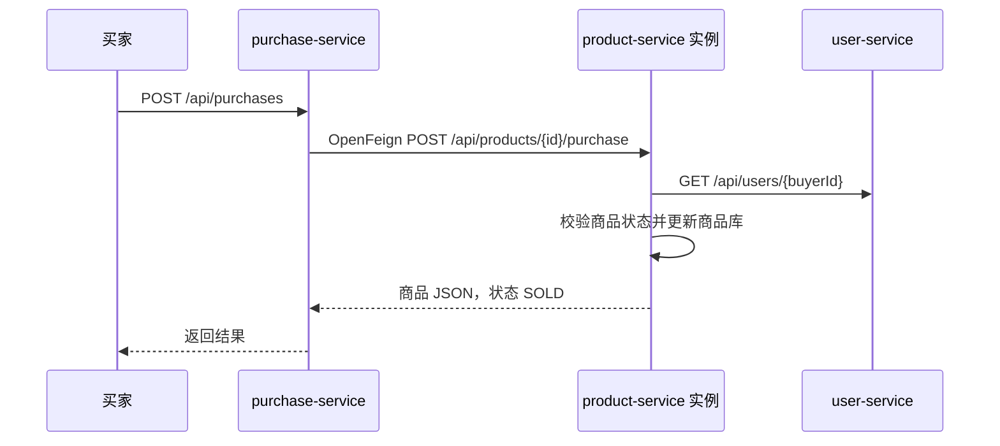

# 商小淘服务通信

购买服务接收商品编号与买家编号，商品服务维护商品状态。OpenFeign 以 `product-service` 为服务名，经 Spring Cloud LoadBalancer 选择实例。两个商品实例共享商品库，只有主实例映射宿主机端口 8080。

购买请求设置 3 秒连接超时与 5 秒读超时，商品服务不可用时返回 HTTP 503。写操作超时后，商品可能已更新但响应未送达。调用方应先查询商品状态，再决定是否重新提交。
